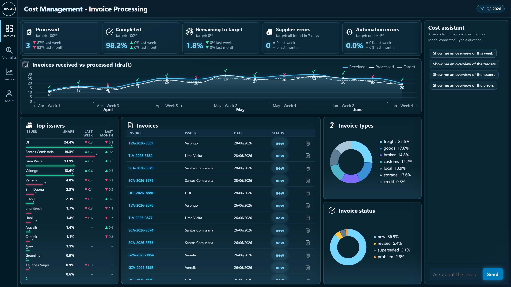
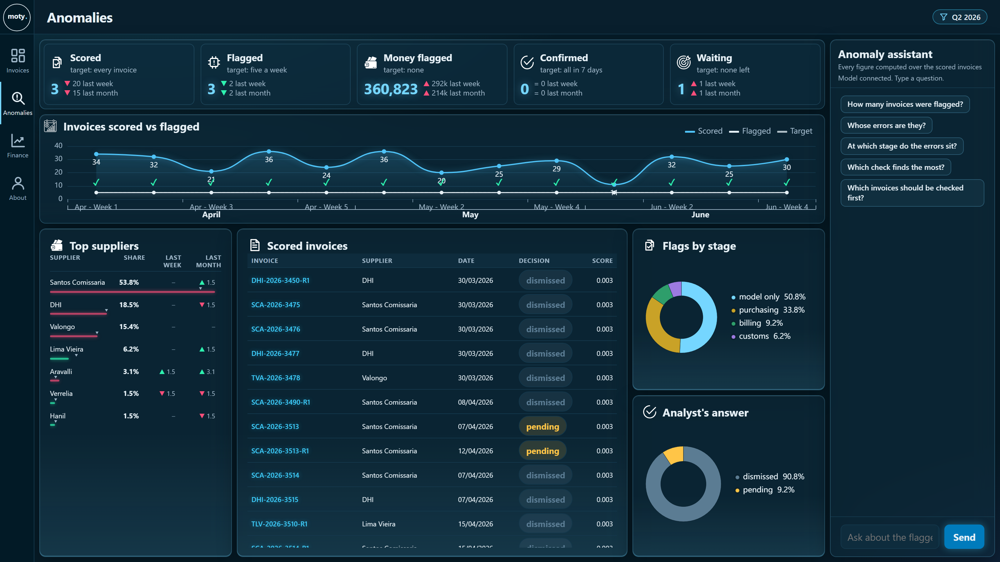
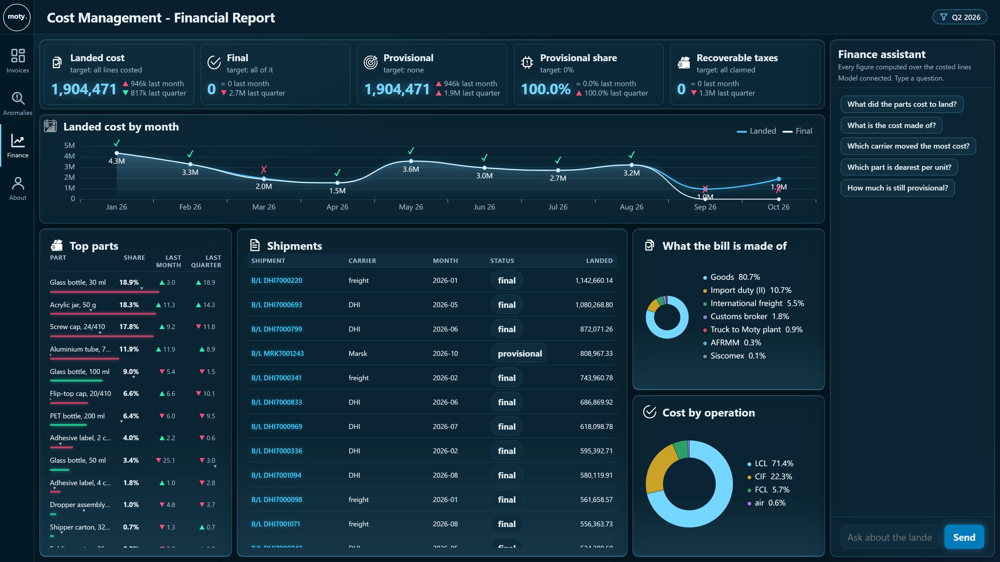
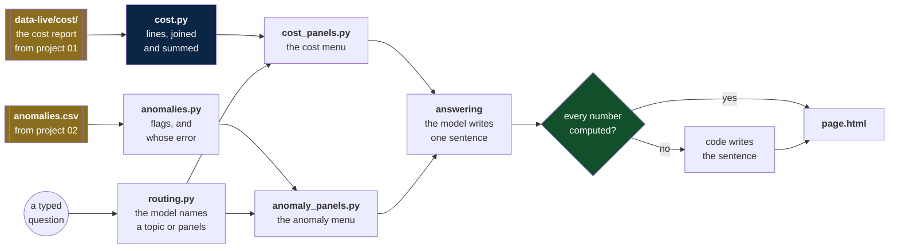

# Landed cost dashboard

Imagine a company called Moty that imports cosmetics packaging: bottles,
caps, pumps, labels. The parts come from factories in Asia by sea and by
air, clear customs in Santos, and ride a truck to the Moty plant.
Its Production and Logistics Cost Management department has one question
about every part: **what did it cost to land, in reais?**

**This project turns that answer into a dashboard you can talk to.**

## The three views

One layout, three views, one rail down the left.

| View | What it answers |
|---|---|
| **Invoices** | how many documents came in this week, how many the reader closed on its own, which issuer sent the most, which ones a person still has to read |
| **Anomalies** | which invoices a checking model flagged, at which stage, by which check, from which supplier, and what the analyst decided |
| **Finance** | what the month cost to land, final apart from provisional, by part, by shipment, by component and by operation |

A fourth button, About, is a page to read. It has no figure to ask about,
so the assistant and the filters are hidden on it.







Every view is laid out the same way: five tiles across the top, a weekly
or monthly chart under them, a ranked list on the left, a table in the
middle, and two donuts down the right. A test walks all three and fails if
one of them puts a card somewhere else.

## The assistant

A column down the right of every view, and a different one on each: the
Invoices assistant answers about the week's documents, the Finance one
about landed cost, the Anomalies one about the flags. Four or five ready
questions are one click each, with no model, no key and no network: the
chip already knows its topic and code writes the whole sentence.

A typed question goes to the model. **The model never produces a number.**
On the Invoices view it answers with one word, the name of a topic, and
code writes the sentence from the desk's own figures. On the Finance and
Anomalies views it names the panels, code computes every figure over the
filtered rows, and only then is the model handed those figures to write
one sentence around them. A test feeds it wrong figures on purpose, and
the answer must still carry the right ones.

One question opens one panel. A question whose answer is a single figure
opens none, because a sentence does not need a picture beside it, and
three pictures bury the dashboard underneath them.

If the model cannot be reached, the answer says so. It does not list what
can be asked, which would read as if the question was the problem.

## The shape of it



Why the model is called twice, and in that order:
[two calls, and in that order](docs/explanation.md#why-two-calls-and-in-that-order).

## Where the data comes from

The data is not invented here. Project 01,
[the invoice pipeline](../01-invoice-pipeline/README.md), reads every
invoice and writes the department's cost report:

| File | One row per |
|---|---|
| `invoices.csv`, `invoice_lines.csv` | document the reader filed, and its lines |
| `landed_cost.csv` | order line and part on a shipment |
| `operations.csv` | shipment: carrier, operation, the goods' month |
| `exceptions.csv` | document a person must read |
| `kpis.json` | the desk's three targets |
| `items.csv`, `vendors.csv` | part names and carrier names |

Project 02, [the anomaly finder](../02-invoice-anomalies/README.md),
scores every invoice into `anomalies.csv`.

One command brings all of it into `data-live/`:

```bash
python refresh_live_data.py
```

The CSV files are committed, so every figure on the dashboard is there
on a fresh clone. The 1,003 invoice pages behind the "open the PDF"
link are not: project 01 draws them in minutes, and that command brings
them across.

What is in there today, measured:

| | |
|---|---|
| invoices read | 1,003, from 2026-01-02 to 2026-10-14 |
| lines on them | 3,940 |
| left for a person | 22 |
| cost lines | 309, on 112 shipments |
| landed cost | 26,483,864.42 in reais, January to October |
| invoices scored | 786 |
| flagged | 163, worth 5,905,553.98 |

The 22 are the reader's own mistakes, not a supplier's. They show on the
Anomalies view as ours, apart from the client's.

`data/` holds a 93-invoice sample with hand-written figures. The tests use
it. The server does not.

## Five minutes

```bash
pip install -r requirements.txt
pip install -r requirements-dev.txt
python -m playwright install chromium

docker compose up -d --build
python -m pytest
```

Open http://localhost:8000. Click one of the ready questions in the
assistant and watch the panel open. A typed question needs the DeepSeek
key: [connect the DeepSeek key](docs/how-to.md#connect-the-deepseek-key).

The 47 look tests drive a real browser against the page, so they need the
server up on port 8000. The other 320 need nothing.

## The files

```
src/
  the data
    cost.py              the cost report becomes lines, and every sum
    anomalies.py         the scored invoices, and whose error each is

  the answer
    panels.py            what a panel is, shared by both menus
    cost_panels.py       the closed menu of the cost view
    anomaly_panels.py    the closed menu of the anomaly view
    routing.py           the model names panels, nothing more
    answering.py         the answer and the number guard, shared
    cost_answering.py    the brief, the sentence and the chips: cost
    anomaly_answering.py the same for the anomaly view
    plot_answers.py      every figure the 24 plots can draw
    model.py             the only file that knows DeepSeek exists

  the page
    web.py               FastAPI: the page and the figures
    page.html            the dashboard, the three views and the assistant

tests/                367 tests, twenty files
data-live/            the real run of projects 01 and 02
data/                 the 93-invoice sample the tests read
reference/            the video this copies, and its frames
99-superseded/        the first version, and what replaced each piece
docs/view-*.png       the four views, as the page serves them today
refresh_live_data.py  one command to bring the other two projects in
check_links.py        every link in the markdown, checked
```

## The documents

Read them in this order. The last two are for looking things up, not for
reading straight through.

| # | Document | Read it when |
|---|---|---|
| 1 | [Tutorial](docs/tutorial.md) | you have never run this and want the whole flow |
| 2 | [Explanation](docs/explanation.md) | you want to know why it is built this way |
| 3 | [Reference](docs/reference.md) | you need an endpoint, a column, or a module |
| 4 | [How-to guide](docs/how-to.md) | you know it already and need a recipe |

Working notes sit beside them. They record how the project was built, not
how to use it:

| Note | What it holds |
|---|---|
| [The agent](docs/the-agent.md) | the ten gaps in the chat half, and which are closed |
| [The look](docs/look.md) | every colour and size, sampled off the video |
| [Replication map](docs/replication-map.md) | each piece of the video, and where it lives |
| [Stack decisions](docs/stack-decisions.md) | why FastAPI, ECharts and DeepSeek |
| [Runbook](docs/runbook.md) | the order the build was done in |

## What the tests pin

| File | Tests | What it defends |
|---|---|---|
| `tests/test_cost.py` | 32 | every cost figure, worked out by hand |
| `tests/test_cost_panels.py` | 16 | the closed menu of the cost view |
| `tests/test_cost_chips.py` | 13 | chips that need no model |
| `tests/test_routing.py` | 29 | the model names panels and nothing more |
| `tests/test_answering.py` | 25 | two calls, and no invented figure |
| `tests/test_refusals.py` | 11 | the honest no |
| `tests/test_end_to_end.py` | 7 | the parts join up |
| `tests/test_web.py` | 32 | the invoice surface, and the key never leaks |
| `tests/test_model.py` | 15 | the DeepSeek client, against a fake transport |
| `tests/test_anomalies.py` | 26 | the flags, and whose error each is |
| `tests/test_anomaly_answering.py` | 16 | the anomaly assistant |
| `tests/test_anomaly_panels_opened.py` | 10 | one panel a question, none for one figure |
| `tests/test_anomaly_desk.py` | 15 | the week the anomaly tiles read |
| `tests/test_anomaly_tiles.py` | 10 | what the five anomaly tiles say |
| `tests/test_anomaly_web.py` | 13 | the anomaly surface |
| `tests/test_finance_month.py` | 14 | the month the finance tiles read |
| `tests/test_finance_web.py` | 17 | the finance surface |
| `tests/test_refresh_live_data.py` | 9 | the one command that brings the data in |
| `tests/test_about.py` | 10 | the About view, its links and its figures |
| `tests/test_look.py` | 47 | colour, size, the overlay and overflow, read from a real browser |

No test touches the network. `test_look.py` is the only one that opens a
browser, and it needs the page served on port 8000.

## The reference material

The behavior this project copies came from a dashboard video.
[`reference/`](reference/) holds what the build was done from: the
author's own description, the frames cut from it, and
[a step-by-step PDF](reference/comportamento-passo-a-passo.pdf) reading
each second of it. The video file itself is somebody else's work and
stays off this repository.

## What this is not

It does not pay anybody or file anything. It reads what the other two
projects wrote and answers questions about it, with every number
traceable to a function and to the lines it covered.
