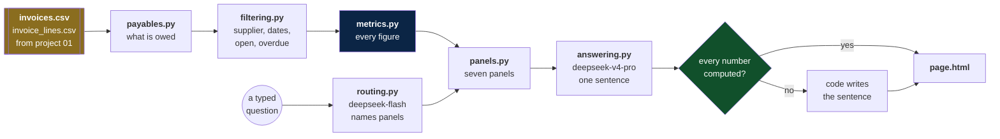

# Payables panel

Imagine a company called Moty that receives invoices every week from
factories in Asia and carriers all over the world. Every invoice it
receives is money it owes.

**This project turns those invoices into a dashboard you can talk to.**

The page shows the whole accounts-payable position. A chat sits under it.
Five ready questions are one click each, with no model and no key. A typed
question goes to the model, which picks the panels to open. The numbers
always come from code.

## The one rule

The model never produces a number. It reads the question and names panels.
Code computes every figure over the filtered rows. Only then is the model
handed the figures, to write a sentence around them. A test feeds it
wrong figures on purpose, and the answer must still carry the right ones.

## The shape of it



The model sits in two boxes and touches no figure in either. The first
call sees the question and the menu. The second sees figures code already
computed. Why that order:
[two calls, and in that order](docs/explanation.md#why-two-calls-and-in-that-order).

## Where the data comes from

The data is not invented. It is the CSV that
[the invoice pipeline](../01-invoice-pipeline/README.md) writes: an
invoice Moty receives is an account payable. The page reads
`data/invoices.csv` and `data/invoice_lines.csv`, the real output of the
other project, 90 documents owed, 1,117,819.58 in total.

Every row on the page opens the PDF it was read from, out of `data/pdf/`.
A total nobody can trace to a document is a total they have to believe.

## Five minutes

```bash
pip install -r requirements.txt
pip install -r requirements-dev.txt
python -m playwright install chromium

python -m pytest          # 306 tests
docker compose up -d --build
```

Open http://localhost:8000. Click one of the five chips and watch the
panels open over the base view with the connecting lines. A typed
question needs the DeepSeek key:
[connect the DeepSeek key](docs/how-to.md#connect-the-deepseek-key).

## One answer, timed

| Step | Who |
|---|---|
| name the panels | `deepseek-flash` |
| compute every figure | code |
| write the sentence | `deepseek-v4-pro` |
| check every number in it | code |

About 6.5 seconds a question, down from twenty. The page shows a waiting
bubble the whole time. What changed and what is still open:
[the agent](docs/the-agent.md).

## The files

```
src/
  the data
    payables.py       the two CSVs become rows, lines and bills
    filtering.py      the filters, and the states open, overdue, credit
    metrics.py        every figure the page can show, and nothing else

  the answer
    panels.py         the closed menu of seven panels
    routing.py        the model names panels, nothing more
    answering.py      the brief, the sentence, and the number guard
    suggestions.py    five chips that need no model
    model.py          the only file that knows DeepSeek exists

  the page
    web.py            FastAPI: the page, the figures, the documents
    page.html         the dashboard, the chat and the overlay

tests/                306 tests, twelve files
reference/            the video this copies, and its frames
docs/                 the four documents, and the working notes
check_links.py        every link in the markdown, checked
```

## The documents

Read them in this order. The last two are for looking things up, not for
reading straight through.

| # | Document | Read it when |
|---|---|---|
| 1 | [Tutorial](docs/tutorial.md) | you have never run this and want the whole flow |
| 2 | [Explanation](docs/explanation.md) | you want to know why it is built this way |
| 3 | [Reference](docs/reference.md) | you need a command, a column, or a module |
| 4 | [How-to guide](docs/how-to.md) | you know it already and need a recipe |

Every page carries the other three at the top, and each section links
across to the matching one.

Five working notes sit beside them. They record how the project was
built, not how to use it:

| Note | What it holds |
|---|---|
| [The agent](docs/the-agent.md) | the ten gaps in the chat half, and which are closed |
| [The look](docs/look.md) | every colour and size, sampled off the video |
| [Replication map](docs/replication-map.md) | each piece of the video, and where it lives |
| [Stack decisions](docs/stack-decisions.md) | why FastAPI, ECharts and DeepSeek |
| [Runbook](docs/runbook.md) | the order the build was done in |

## What the tests pin

| File | Tests | What it defends |
|---|---|---|
| `tests/test_payables.py` | 23 | the two CSVs become rows, lines and bills |
| `tests/test_filtering.py` | 26 | the filters, and what the data lacks |
| `tests/test_metrics.py` | 56 | every figure, by name, nothing else |
| `tests/test_panels.py` | 13 | the closed menu of panels |
| `tests/test_routing.py` | 34 | the model names panels and nothing more |
| `tests/test_answering.py` | 32 | two calls, and no invented figure |
| `tests/test_refusals.py` | 15 | the honest no |
| `tests/test_suggestions.py` | 15 | chips that need no model |
| `tests/test_web.py` | 35 | the page surface, and the key never leaks |
| `tests/test_model.py` | 15 | the DeepSeek client, against a fake transport |
| `tests/test_end_to_end.py` | 13 | the parts join up |
| `tests/test_look.py` | 29 | colour, size and overflow, read from a real browser |

No test touches the network. `test_look.py` is the only one that opens
a browser.

## The reference material

The behavior this project copies came from a video, saved in
[`reference/`](reference/), with the author's description, the frames cut
from it, and [a step-by-step PDF](reference/comportamento-passo-a-passo.pdf).

## What this is not

It does not pay anybody or file anything. It reads what the other project
wrote and answers questions about it, with every number traceable to a
function and to the rows it covered.
